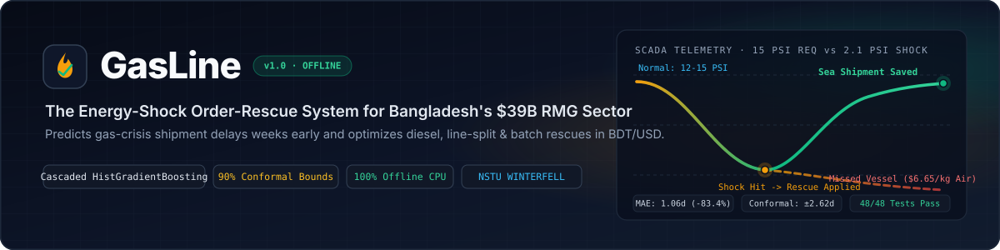
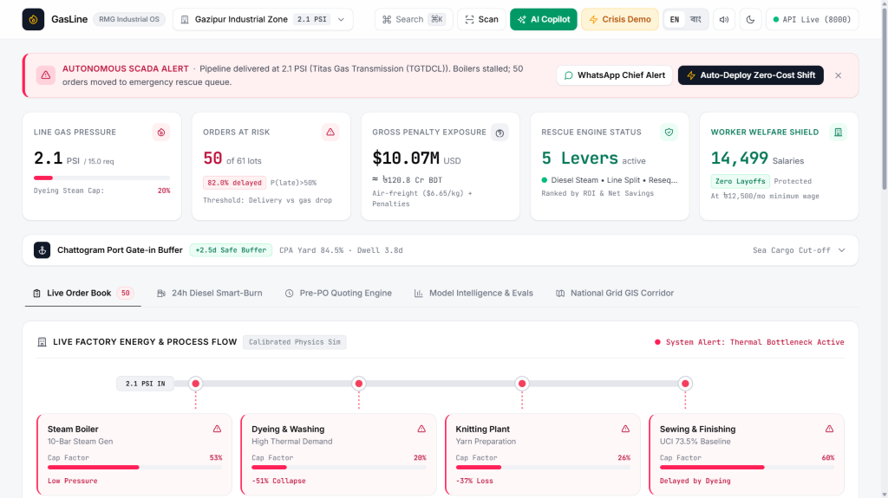
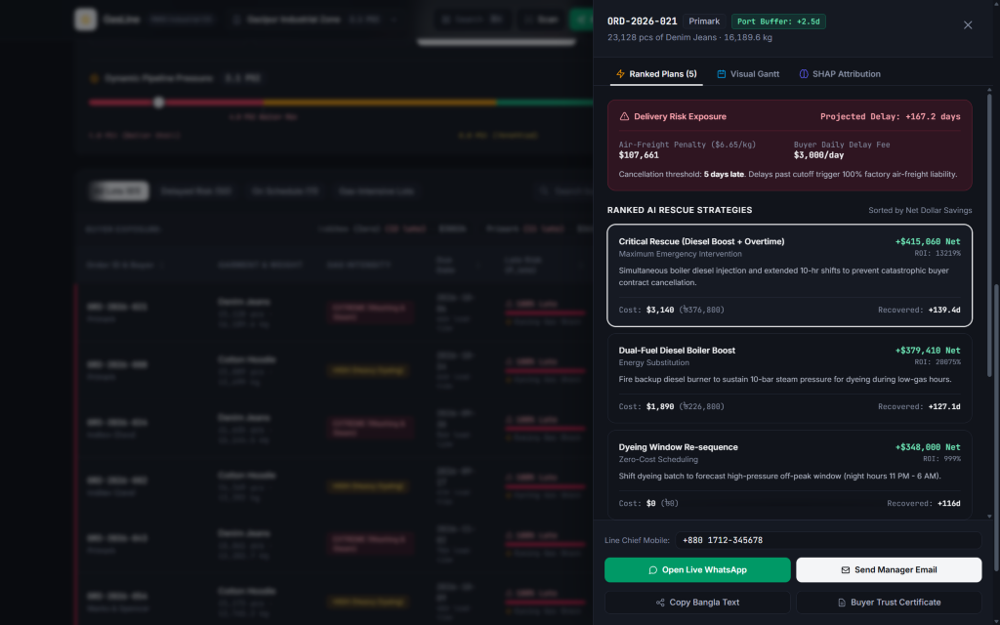
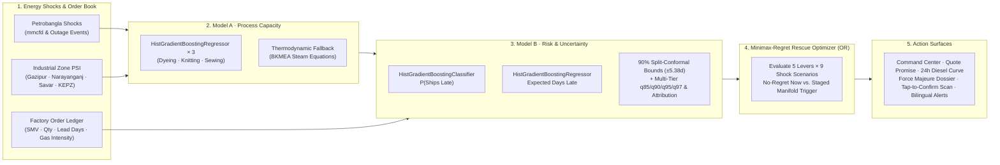

<div align="center">



<br /><br />

[](https://github.com/sovon1/Gasline/actions/workflows/ci.yml)
[](LICENSE)
[](backend/src/server.py)
[](frontend/package.json)
[](backend/src/test_backend.py)
[](#60-second-local-quickstart)

**Predicts which export orders the Bangladesh gas crisis will make late — and what ship date to safely promise before signing — then prices the cheapest rescue against air freight.**

[Final-Day Challenges](#final-day-judge-challenges-implemented) · [Live Screenshots](#live-application-screenshots) · [System Architecture](#system-architecture) · [ML Benchmarks](#verified-model-evaluation--ablation) · [60s Quickstart](#60-second-local-quickstart) · [IEEE Research Paper](frontend/public/gasline_ieee_paper.pdf)

</div>

---

## Executive Summary

Bangladesh's **$39B+ Ready-Made Garment (RMG) sector** generates **over 80% of national export earnings**, yet factories are currently throttled not by demand, but by natural gas pressure collapses. Boilers for wet dyeing and washing require **10–15 PSI**, while factories in Gazipur, Narayanganj, and Savar frequently receive **1–3 PSI**. Every factory manager knows gas pressure is low — what no merchandiser can see early enough is **which specific export lot will miss its vessel cut-off because of it**, and **whether diesel, overtime, line splitting, or night re-sequencing saves money vs. $6.00–$7.50/kg emergency air freight**.

**GasLine** connects national gas shock telemetry (`mmcfd` & zone PSI), process-specific thermal physics (`dyeing → knitting → sewing`), and factory order books into one calibrated risk, quoting & rescue engine that runs **100% offline on an ordinary factory laptop CPU in milliseconds**.

---

## Final-Day Judge Challenges Implemented

**Team `#28 · NSTU Winterfell`** — **Direction: *Promise date at quotation time***

| Challenge | What Was Built & Verified | Key Surfaces & Code |
|---|---|---|
| **1. Pre-PO Safe Ship-Date Promise** <br/>*Let a merchandiser enter a new order quote, and have GasLine return the ship date it can safely promise before accepting.* | Promoted **`PROMISE`** (*Pre-PO Quoting Engine*) to **Tab 1** + added a **`Quote PO`** header button. A merchandiser enters buyer, garment style/SMV, quantity, FOB price, gas intensity, quotation date, buyer target date, CPA port buffer (`+2.5d`), and WIP queue load. `compute_quote_promise()` sweeps candidate lead horizons through **Model A → Model B** (`6,000` orders across `10–105` lead days) to return exact calendar dates (`YYYY-MM-DD`) at **50% Floor**, **85% Commercial**, **90% Conformal Safe (Recommended)**, and **97% Bulletproof**, an interactive SVG confidence curve, a **Pre-Signing Rescue FOB Table** (`+$USD/pc` markup to hold tight buyer dates), 1-click **Copy Memo** & **A4 Quote PDF** export, and direct PO commitment to the Live Order Book. | `POST /api/quote-promise` · [`compute_quote_promise()`](backend/src/optimizer.py) · [`PromiseDateEngine.tsx`](frontend/components/PromiseDateEngine.tsx) · [`plainDate.ts`](frontend/utils/plainDate.ts) · [`auditPdf.ts`](frontend/utils/auditPdf.ts) |
| **2. Honest Rescue Ranking Under Unconfirmed Shocks** <br/>*Keep the rescue ranking honest when a shock event is announced with no confirmed duration or affected zone.* | Added `shock_mode="unconfirmed"` (`duration_confirmed=False`, `zone_confirmed=False`, duration min/max range, zone hit prior) across the Shock Console, Quoter, and Rescue Drawer (including a **3×3 Scenario Grid** tab). `evaluate_rescue_plans()` evaluates all 5 levers across a **9-scenario matrix** (`Zone Spared / Spillover / Direct Hit` × `Short / Medium / Prolonged Duration`) with duration-scaled diesel/overtime costs and sunk mobilization penalties — replacing single-point ROI with `net_saving_range_usd`, `cost_range_usd`, `max_regret_usd`, and **2-stage honest badges**: **`Execute Now (No-Regret)`** (`$0` Night Re-sequence, `$150` Line Split) vs. **`Hold Cash · Stage Trigger`** (`< 3.5 PSI for ≥ 24h` manifold verification before burning diesel/overtime cash). | [`evaluate_rescue_plans()`](backend/src/optimizer.py) · `POST /api/rescue` · `POST /api/simulate-shock` · [`ShockConsole.tsx`](frontend/components/ShockConsole.tsx) · [`RescueDrawer.tsx`](frontend/components/RescueDrawer.tsx) |

*(Covered by automated backend contract & physics tests `test_49`–`test_56` in [`backend/src/test_backend.py`](backend/src/test_backend.py).)*

---

## The Crisis in Numbers

| Metric | Observed Reality | Source / Benchmark |
|---|---|---|
| **Required vs. Delivered Pressure** | **15 PSI** required vs **1–3 PSI** received | BKMEA Crisis Survey (Aug–Sep 2026) |
| **Partial Factory Shutdowns** | **78%** of surveyed RMG factories hit | BKMEA / Daily Sun (2026) |
| **Shipment Delays & Cancellations** | **87%** delayed shipments · **55%** lost or shrank orders | BKMEA Crisis Survey (Aug–Sep 2026) |
| **Stage-Specific Process Loss** | **Dyeing −51%** · **Knitting −37/38%** · **Sewing −40%** | BKMEA Published Sector Survey |
| **National Supply Deficit** | **2,235 mmcfd** (Aug 2026 avg) vs **~3,800 mmcfd** demand | The Daily Star / Petrobangla |
| **Nov 2026 Summit LNG Shock** | **2,570 → 2,250 mmcfd** maintenance cut (4–7 Nov 2026) | UNB / bdnews24 (3 Nov 2026) |
| **Air vs. Sea Freight Penalty** | **~20× cost jump**: `$6.00–$7.50/kg` air vs `$0.30–$0.35/kg` sea | Modeled at `$6.65/kg` net exposure |
| **Diesel vs. Gas Steam Cost** | **~৳34/unit** diesel vs **৳14–15/unit** pipeline gas | Factory fuel-substitution economics |

---

## Live Application Screenshots

<table>
  <tr>
    <td width="50%" align="center">
      <strong>SCADA Command Center &amp; Process Flow (Light Mode)</strong><br /><br />
      
    </td>
    <td width="50%" align="center">
      <strong>Order Rescue Optimizer &amp; ROI Drawer (Dark Mode)</strong><br /><br />
      
    </td>
  </tr>
</table>

---

## System Architecture

Instead of shipping disconnected dashboards or hard-coding PSI thresholds, GasLine learns non-linear process sensitivity across one continuous causal chain and re-uses the same trained models across **Decision**, **Communication**, and **Data-Acquisition** surfaces.



> Deep-dive technical details: [Technical Architecture (`docs/ARCHITECTURE.md`)](docs/ARCHITECTURE.md)

---

## What Is Genuinely ML — and What Is Not

| Component | Technology | Epistemic Role & Design Honesty |
|---|---|---|
| **A. Process Capacity Forecaster** | `HistGradientBoostingRegressor` × 3 (`model_a_capacity.pkl`) | **True ML.** Learns non-linear dyeing, knitting, and sewing collapse curves from line PSI, 3-day rolling PSI, lagged PSI, mmcfd supply, and outage zone flags (with deterministic thermodynamic fallback). |
| **B. Order Late-Risk & Delay Engine** | `HistGradientBoostingClassifier` + `Regressor` + Split Conformal | **True ML.** Integrates order scale, SMV, gas intensity, lead slack, and Model A window capacity across 11 engineered features, wrapped in calibrated **multi-tier split-conformal intervals** (`q85=±4.19d`, `q90=±5.38d`, `q95=±7.59d`, `q97=±9.94d`) and **marginal driver attribution**. |
| **B2. Buyer Exposure Ledger** | Group-by Aggregation of Model B | **Aggregation (Not Separate ML).** Rolls order-level risk up per buyer (`Inditex (Zara)`, `H&M`, `Marks & Spencer`, `Primark`) so merchandisers protect threatened relationships. |
| **C. Rescue Optimizer & Quote Sweep** | Deterministic Operations Research (`optimizer.py`) | **Operations Research (Not ML).** Sweeps quotation horizons (`compute_quote_promise`) and scores 5 rescue interventions across confirmed states or a **9-scenario unconfirmed shock grid** (`Spared/Spillover/Direct × Short/Med/Long`), ranking by net savings & minimax regret. |
| **Shopfloor Board Digitizer** | Photo Preview + Tap-to-Confirm 6-Field Template | **Honest Build-Now Design.** Explicitly avoids fragile Bangla handwriting OCR in favor of local board photo preview + editable 6-field confirmation scored live through Model B. |
| **Force Majeure Preparation** | Printable Bilingual Evidence Dossier & Buyer Notice | **Documentation Support.** Compiles SCADA shock telemetry, conformal bounds, Scope-1 diesel mitigation logs, and BERC Act 2003 §42 / CISG Art. 79 context as a factory draft for review — **not** an official regulator certificate. |

---

## Verified Model Evaluation & Ablation

Evaluated across `6,000` seeded orders (`70%` train / `15%` conformal calibration / `15%` holdout test; `4,200` train / `900` calibration / `900` holdout test across `10–105` lead days) reported directly by [`backend/models/model_metadata.json`](backend/models/model_metadata.json) and `GET /api/benchmark`:

| Benchmark | Result | Ablation Baseline Comparison |
|---|---:|---|
| **Late-Risk Classifier ROC-AUC** | **`0.9991`** | Non-linear energy + slack interactions |
| **Classification Accuracy** | **`98.67%`** | Precision `98.96%` · Recall `98.54%` |
| **Days-Late Regression MAE** | **`2.12 days`** | **−66.7% error reduction** vs baseline tabular GBDT (`6.37 days`) |
| **90% Conformal Interval (`q90`)** | **`±5.38 days`** | **−46.7% tighter** than uncalibrated interval (`±10.10 days`); multi-tier `q85=±4.19d`, `q95=±7.59d`, `q97=±9.94d` |
| **Automated Test Suite** | **`56 / 56` OK** | 100% offline FastAPI `TestClient` suite (`backend/src/test_backend.py`) |

> **Validation Scope & Honest Boundaries:** These accuracy and ablation figures are measured on a **calibrated synthetic holdout** anchored to the real **UCI Garment Productivity** dataset (`1,199` data rows, DOI `10.24432/C51S6D`), published **BKMEA crisis loss rates**, and cited **Petrobangla shock notices**. Real-factory generalization is unclaimed prior to our **Cumilla EPZ 1-month real Excel/ERP order-book pilot**. See [`docs/DATA_SOURCES.md`](docs/DATA_SOURCES.md) for the complete provenance audit.

---

## 5 Priced Rescue Interventions

For every at-risk order, `evaluate_rescue_plans()` in [`backend/src/optimizer.py`](backend/src/optimizer.py) evaluates 5 factory actions (`USD_TO_BDT = 120.0`, `$6.65/kg` air-vs-sea differential):

| Plan ID | Intervention | Category | Cost (USD) | Cost (BDT) | Operational Lever |
|---|---|---|---:|---:|---|
| `resequence_dyeing` | **Dyeing Window Re-sequence** | Zero-Cost Scheduling | `$0` | `৳0` | Shift dyeing batches to off-peak night windows (`11 PM – 6 AM`) |
| `line_split` | **Parallel Line Split** | Capacity Reallocation | `$150` | `৳18,000` | Split cutting & sewing across 2 parallel assembly lines |
| `overtime_shift` | **2-Hour Daily Overtime** | Workforce Mobilization | `$1,250` | `৳150,000` | Extend 20 line workers to 10-hr shifts (`৳250/hr` overtime rate) |
| `diesel_steam_boost` | **Dual-Fuel Diesel Boiler Boost** | Energy Substitution | `$1,890` | `৳226,800` | Fire backup diesel burner to restore 10-bar dyeing steam |
| `diesel_plus_overtime` | **Critical Rescue (Diesel + Overtime)** | Emergency Intervention | `$3,140` | `৳376,800` | Combined boiler diesel boost + 10-hr shifts for urgent buyouts |

---

## 60-Second Local Quickstart

**Prerequisites:** Python `3.12+` and Node.js `20+` (or `22 LTS`). **No API keys or GPUs required.**

<details open>
<summary><strong>Windows (PowerShell)</strong></summary>

```powershell
git clone https://github.com/sovon1/Gasline.git
cd Gasline

# Terminal 1 — Start FastAPI + scikit-learn Backend (http://127.0.0.1:8000)
python -m venv .venv
.\.venv\Scripts\Activate.ps1
pip install -r backend\requirements.txt
uvicorn server:app --app-dir backend\src --host 127.0.0.1 --port 8000

# Terminal 2 — Start Next.js 16 Frontend (http://localhost:3000)
cd frontend
npm ci
npm run build
npm run start
```

</details>

<details>
<summary><strong>macOS / Linux (Bash)</strong></summary>

```bash
git clone https://github.com/sovon1/Gasline.git
cd Gasline

# Terminal 1 — Start FastAPI + scikit-learn Backend (http://127.0.0.1:8000)
python3 -m venv .venv
source .venv/bin/activate
pip install -r backend/requirements.txt
uvicorn server:app --app-dir backend/src --host 127.0.0.1 --port 8000

# Terminal 2 — Start Next.js 16 Frontend (http://localhost:3000)
cd frontend
npm ci
npm run build
npm run start
```

</details>

### Verify & Reproduce From Scratch

```bash
# 1. Verify model imports & inference (~1s)
python backend/src/test_verification.py

# 2. Run all 56 automated FastAPI contract, physics & conformal tests (~31s, zero network)
python backend/src/test_backend.py

# 3. Retrain Model A + Model B from shipped CSVs on CPU (~3s)
python backend/src/train_models.py
```

*(Optional AI Copilot enhancement: copy [`.env.example`](.env.example) to `.env` if you want to provide `GEMINI_API_KEY`, `GROQ_API_KEY`, or `OPENAI_API_KEY`. When offline or unconfigured, GasLine automatically serves its deterministic SCADA engine backed by live Model A/B calculations.)*

---

## Complete FastAPI Endpoint Reference

<details>
<summary>View all 16 API routes served at <code>http://127.0.0.1:8000</code></summary>

| Method | Endpoint | Purpose |
|---|---|---|
| `GET` | `/health` | System health, loaded order count, model accuracy, `conformal_q90`, CPA port buffer |
| `GET` | `/api/orders` | Returns active export order book with NaN/Inf-sanitized schemas |
| `GET` | `/api/orders/{order_id}` | Case-insensitive lookup for a single export order lot |
| `POST` | `/api/orders` | Adds single lot or batch CSV/JSON orders with live Model B inference |
| `GET` | `/api/shocks` | Returns cited Petrobangla / BKMEA energy shock presets |
| `POST` | `/api/simulate-shock` | Evaluates national supply (`mmcfd`), zone PSI, and confirmed vs. unconfirmed shock envelopes across the entire ledger |
| `POST` | `/api/rescue` | Runs Model B counter-factual scoring over all 5 rescue actions (including 9-scenario minimax-regret mode under unconfirmed shocks) |
| `POST` | `/api/quote-promise` | Forward-sweeps a pre-PO merchandiser quote through Model A/B + CPA buffer to return 50/85/90/97% calendar ship dates & FOB rescue pricing |
| `GET` | `/api/port-buffer` | Returns Chattogram Port Authority (CPA) yard occupancy & gate-in buffer days |
| `GET` | `/api/benchmark` | Returns ROC-AUC, Accuracy, MAE, conformal `q90`, and baseline ablation metrics |
| `POST` | `/api/alert-text` | Generates structured bilingual (`EN` / `বাংলা`) merchandiser alert copy |
| `POST` | `/api/dispatch-alert` | Formats WhatsApp / Email / SMS dispatch payloads with deep links |
| `POST` | `/api/copilot/chat` | Multi-provider LLM copilot (`Gemini`, `Groq`, `OpenAI`, `Ollama`) + offline SCADA engine |
| `POST` | `/api/copilot/models` | Dynamically discovers available models or serves curated offline defaults |
| `POST` | `/api/vision/scan-card` | Runs live Model B risk scoring on confirmed shopfloor template fields |
| `POST` | `/api/force-majeure` | Compiles bilingual Factory Evidence Dossier & Draft Buyer Notice with conformal bounds |

</details>

---

## Research Paper & Deep-Dive Documentation

- **IEEE-Format Research Paper**: [`frontend/public/gasline_ieee_paper.pdf`](frontend/public/gasline_ieee_paper.pdf)
- **Technical Architecture & ML Math**: [`docs/ARCHITECTURE.md`](docs/ARCHITECTURE.md)
- **Data Provenance & Calibration Audit**: [`docs/DATA_SOURCES.md`](docs/DATA_SOURCES.md)

---

## Project Structure

```text
gasline/
├── .github/workflows/ci.yml      # GitHub Actions: 56 backend tests, CPU retrain check & Next.js build
├── backend/
│   ├── data/
│   │   ├── uci_garment_productivity.csv   # Real Bangladeshi factory baseline (1,199 rows, UCI DOI 10.24432/C51S6D)
│   │   ├── bkmea_shocks.csv               # 5 source-cited Petrobangla & BKMEA crisis events
│   │   ├── daily_capacity.csv             # 90-day calibrated capacity curves (seed=42)
│   │   └── simulated_orders.csv           # 60 seeded RMG export lots across 4 buyers
│   ├── models/
│   │   ├── model_a_capacity.pkl           # Model A: 3 process capacity regressors (dyeing, knitting, sewing)
│   │   ├── model_b_classifier.pkl         # Model B: P(late) HistGradientBoostingClassifier
│   │   ├── model_b_regressor.pkl          # Model B: Expected days-late HistGradientBoostingRegressor
│   │   └── model_metadata.json            # Feature manifest, conformal quantiles (q85–q97) & evaluation metrics
│   ├── src/
│   │   ├── simulator.py                   # Seeded RMG energy-shock simulator anchored to UCI + BKMEA
│   │   ├── train_models.py                # Reproducible 70/15/15 ML + split-conformal training script
│   │   ├── optimizer.py                   # Model A/B inference, quote-promise sweep & 9-scenario minimax-regret rescue engine
│   │   ├── server.py                      # 16-endpoint FastAPI server with NaN safety & offline fallback
│   │   ├── test_backend.py                # 56 comprehensive automated tests (contract, edge-case, quote & unconfirmed shock scenarios)
│   │   └── test_verification.py           # Fast sanity smoke check
│   └── requirements.txt
├── frontend/
│   ├── app/                               # Next.js 16 App Router (`page.tsx`, `layout.tsx`, `globals.css`)
│   ├── components/                        # Interactive SCADA flow, Order Ledger, Rescue Drawer, Modals
│   ├── data/                              # EN/বাংলা translations, snapshot orders, seeded industrial clusters
│   ├── public/gasline_ieee_paper.pdf      # Bundled IEEE technical paper
│   └── package.json                       # Next.js 16.4.6 · React 19.3 · Tailwind CSS v4 · TypeScript 5
├── docs/
│   ├── assets/banner.svg                  # Vector repository hero banner
│   ├── screenshots/                       # Verified 1440×900 Light & Dark UI captures
│   ├── ARCHITECTURE.md                    # ML features, fallback equations & optimizer math
│   └── DATA_SOURCES.md                    # Dataset audit & pilot replacement roadmap
├── .env.example
└── LICENSE                                # MIT License
```

---

## Honest Boundaries & Pilot Pathway

1. **Calibrated Simulation Pending ERP Pilot**: Order-level ERP ledgers are private across Bangladesh's RMG industry; GasLine is trained on UCI/BKMEA-calibrated physics (`simulated_orders.csv`) and explicitly awaits a **1-month pilot in Cumilla EPZ / BKMEA member factories** to retrain on live production books.
2. **No Live Petrobangla API Feed**: Shocks currently enter via cited Petrobangla scenario presets and manual PSI controls; multi-factory groups resolve this via GasLine's zone Pressure Network.
3. **Capital-Smart Allocation, Not Gas Generation**: GasLine cannot add gas molecules to the grid — it routes scarce steam, diesel, overtime, and parallel lines strictly toward orders where late penalties and `$6.65/kg` air-freight gaps are highest.

---

## Team — NSTU WINTERFELL

Built for **CoU AI Hackathon 2026** by **Dept. of Computer Science & Telecommunication Engineering, Noakhali Science and Technology University (NSTU)**:

| Role | Name | Student ID | Affiliation |
|---|---|---|---|
| **Team Leader** | **Md. Shahidul Islam Shovan** | `ASH2301019M` | CSTE · NSTU |
| **Member** | **Syeda Samiha Kader Chowdhury** | `BKH2301002F` | CSTE · NSTU |
| **Member** | **Shariar Ebtasam** | `ASH2301020M` | CSTE · NSTU |

---

<div align="center">

Released under the [MIT License](LICENSE) · Engineered offline for Bangladesh's RMG Merchandisers & Production Managers

</div>
