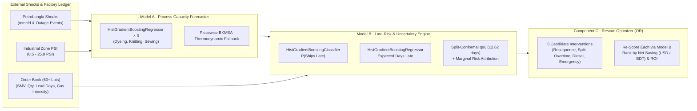

# GasLine Technical Architecture

This document details GasLine's end-to-end machine learning pipeline, thermodynamic process-capacity model, conformal uncertainty bounds, operations-research rescue optimizer, FastAPI backend, and Next.js frontend.

---

## 1. System Dataflow & Causal Chain

---

## 2. Cascaded ML & Physics Engine

All ML models are implemented in pure **scikit-learn (`HistGradientBoosting`)** and serialized in [`backend/models/`](../backend/models/) for sub-millisecond CPU inference with zero GPU dependencies. Training logic lives in [`backend/src/train_models.py`](../backend/src/train_models.py) and inference/optimization logic lives in [`backend/src/optimizer.py`](../backend/src/optimizer.py).

### 2.1 Component A: Process Capacity Forecaster (`model_a_capacity.pkl`)

Energy scarcity does not degrade every garment stage equally: boiler steam required for dyeing/washing collapses nonlinearly below ~4–5 PSI, whereas cutting and sewing lose comparatively less capacity.

- **Model Family**: Three separate `HistGradientBoostingRegressor` models (`max_iter=150`, `max_leaf_nodes=20`, `learning_rate=0.08`, `random_state=42`).
- **5 Input Features**:
  1. `gas_pressure_psi` — active zone line pressure (clamped to `[0.5, 25.0]` PSI)
  2. `national_supply_mmcfd` — national gas grid supply (mmcfd)
  3. `rolling_psi_3d` — 3-day rolling pressure mean
  4. `psi_lag1` — previous-day line pressure
  5. `is_outage_zone` — binary indicator (`1` if `gas_pressure_psi < 4.0`)
- **3 Outputs** (bounded to physical floor/ceiling ranges):
  - `dyeing_capacity_factor` (`[0.05, 0.98]`)
  - `knitting_capacity_factor` (`[0.10, 0.98]`)
  - `sewing_capacity_factor` (`[0.20, 0.98]`)
- **Thermodynamic Physics Fallback**: If pickle artifacts are absent, `predict_process_capacities()` falls back to calibrated piecewise BKMEA response equations:
  - `psi < 4.0`: `dyeing = 0.49 * (psi / 4.0)`, `knitting = 0.63 * (psi / 4.0)`, `sewing = 0.60`
  - `4.0 <= psi < 8.0`: `dyeing = 0.70 + (psi - 4.0) * 0.05`, `knitting = 0.80 + (psi - 4.0) * 0.03`, `sewing = 0.82`
  - `psi >= 8.0`: `dyeing = 0.95`, `knitting = 0.98`, `sewing = 0.95`

### 2.2 Component B: Order Late-Risk Classifier & Days-Late Regressor

Model B consumes factory order parameters together with Model A's predicted thermal capacity over the order window (`N = 5,000` seeded orders generated in `train_models.py`, split **70% train / 15% conformal calibration / 15% holdout test**).

- **Model Family**:
  - `model_b_classifier.pkl` — `HistGradientBoostingClassifier` (`max_iter=250`, `max_leaf_nodes=31`, `learning_rate=0.08`, `min_samples_leaf=15`) predicting `P(ships late)`.
  - `model_b_regressor.pkl` — `HistGradientBoostingRegressor` (same hyperparameters) predicting expected `days_late`.
- **11 Engineered Features** (`backend/models/model_metadata.json`):
  - Order properties: `quantity`, `weight_kg`, `base_smv`, `gas_intensity_code` (`LOW=0`, `MEDIUM=1`, `HIGH=2`, `EXTREME=3`), `lead_days`
  - Energy context: `avg_window_psi`, `avg_dyeing_capacity`
  - Domain manufacturing physics (anchored to 20 workers × 480 min × ~0.735 UCI baseline productivity = `7,056 mins/day`):
    - `workload_minutes = quantity * base_smv`
    - `standard_days = workload_minutes / 7056.0`
    - `workload_ratio = standard_days / lead_days`
    - `lead_slack = lead_days - standard_days`

### 2.3 Split-Conformal Uncertainty Bounds & Feature Attribution

- **Split-Conformal 90% Interval (`conformal_q90 = ±2.62 days`)**:
  Computed on the 15% calibration split via $\alpha = 0.10$ empirical residual quantile $|y_{\text{calib}} - \hat{y}_{\text{calib}}|$. Every predicted delay reports a bounded 90% interval `[\max(0, \hat{y} - 2.62), \hat{y} + 2.62]` so merchandisers never rely on brittle point guesses.
- **Per-Order Marginal Risk Attribution (`compute_shap_attribution`)**:
  Decomposes each order's late risk into four normalized percentage drivers:
  - `Dyeing Gas Shock` (`dyeing_gas_collapse_pct`)
  - `Lead Time Slack` (`lead_slack_deficit_pct`)
  - `SMV Complexity` (`garment_smv_complexity_pct`)
  - `Batch Volume Load` (`batch_volume_scale_pct`)

### 2.4 Synthetic Holdout Validation & Ablation Metrics

From [`backend/models/model_metadata.json`](../backend/models/model_metadata.json) and `/api/benchmark`:

| Metric | Value | Comparison / Note |
|---|---|---|
| Classifier ROC-AUC | `0.9998` | Synthetic holdout split (`random_state=42`) |
| Classifier Accuracy | `99.33%` | Precision `99.48%` · Recall `99.22%` |
| Days-Late MAE | `1.06 days` | **-83.4%** vs baseline tabular GBDT (`6.37 days`) |
| Conformal 90% Margin | `±2.62 days` | **-74.1%** narrower vs uncalibrated interval (`±10.10 days`) |

> **Honest Validation Scope**: These numbers evaluate the models on a **calibrated synthetic holdout** (5,000 orders anchored to UCI Garment Productivity and BKMEA process loss physics). Real-world factory accuracy requires a **1-month pilot using live Excel/ERP order books from Cumilla EPZ / BKMEA member factories**.

---

## 3. Component C: Rescue Optimizer (Operations Research)

`evaluate_rescue_plans()` in [`backend/src/optimizer.py`](../backend/src/optimizer.py) is deterministic **operations research (not ML)** whose intelligence comes from querying Model B for each candidate plan:

1. **Baseline Exposure Calculation**:
   - $\text{air\_freight\_gap} = \$6.65/\text{kg}$ (`$7.00/kg` emergency air freight minus `$0.35/kg` sea freight, triggered when $P(\text{late}) > 0.4$)
   - $\text{delay\_fees} = \text{predicted\_days\_late} \times \text{penalty\_per\_day\_usd}$
   - $\text{USD\_TO\_BDT} = 120.0$
2. **Candidate Re-Scoring**: Each of the 5 interventions adjusts effective dyeing capacity, pressure delta, and/or effective lead-time slack (`resequence_dyeing`, `line_split`, `overtime_shift`, `diesel_steam_boost`, `diesel_plus_overtime`), re-runs `predict_order_risk()`, computes `avoided_loss_usd`, subtracts intervention cost to yield `net_saving_usd` and `roi_pct`, and ranks plans descending by net saving.

---

## 4. Backend API Architecture (`backend/src/server.py`)

- **Framework**: FastAPI + Pydantic v2, CORS-enabled for local frontend development (`http://127.0.0.1:8000`).
- **NaN/Inf Immunity**: All JSON responses pass through `sanitize_value()` / `sanitize_record()` and `_safe_float()` / `_safe_int()` guards to eliminate serialization crashes on missing or malformed CSV/JSON fields.
- **Multi-Provider AI Copilot with Offline Fallback**: `POST /api/copilot/chat` integrates Google Gemini, Groq, OpenAI, or local Ollama when an API key / local endpoint is supplied, and transparently falls back to a deterministic SCADA reasoning engine backed by live Model A/B calculations when offline.
- **Vision Scan & Force Majeure Endpoints**:
  - `POST /api/vision/scan-card`: Scores digitized production-board fields through live Model B inference (paired in the UI with a Photo + Tap-to-Confirm Grid Template).
  - `POST /api/force-majeure`: Generates a bilingual Factory Force Majeure Evidence Dossier & Draft Buyer Notice with conformal bounds and diesel Scope-1 emissions accounting.

---

## 5. Frontend Architecture (`frontend/`)

- **Framework**: Next.js `16.4.6` (App Router) + React `19.3.0` + TypeScript `^5` + Tailwind CSS `4.3.3` (`@tailwindcss/turbopack`).
- **Unified Light/Dark Theme**: Implemented in [`frontend/app/globals.css`](../frontend/app/globals.css) and [`frontend/utils/theme.ts`](../frontend/utils/theme.ts) using native CSS `light-dark()` tokens and `color-scheme: light dark`.
- **Native Web Standards**: Uses native `<dialog>` elements via [`ModalDialog.tsx`](../frontend/components/ModalDialog.tsx), native Popover API (`popover` attributes), keyboard-first `⌘K` Command Palette ([`CommandPalette.tsx`](../frontend/components/CommandPalette.tsx)), and toast alerts ([`ToastProvider.tsx`](../frontend/components/ToastProvider.tsx)).
- **Resilient Offline Operation**: Bundles snapshot data ([`frontend/data/initial_orders.json`](../frontend/data/initial_orders.json)) and deterministic client-side fallbacks so interactive views, EN/বাংলা translation switching ([`translations.ts`](../frontend/data/translations.ts)), and printable buyer notices remain responsive even if the API server is stopped.
